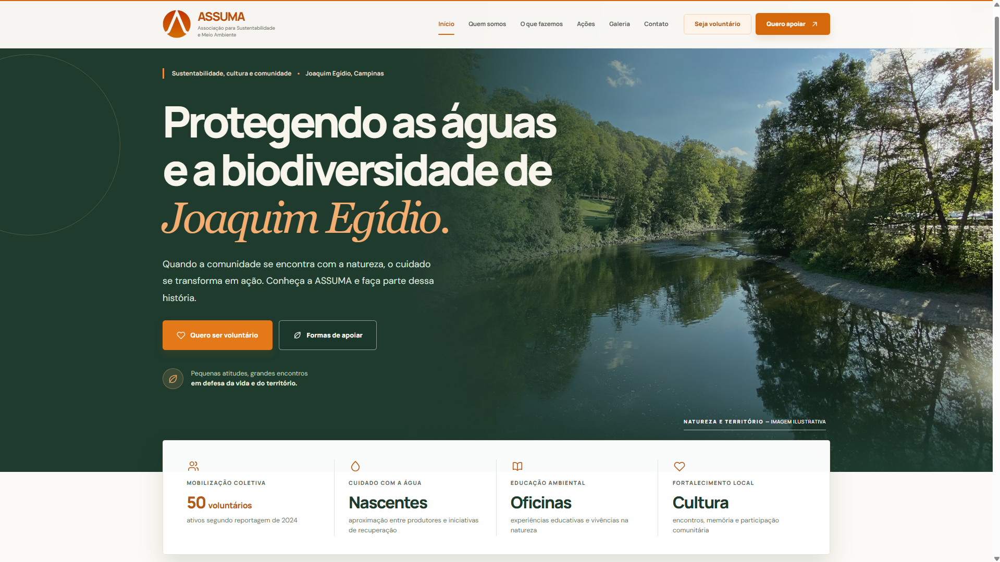
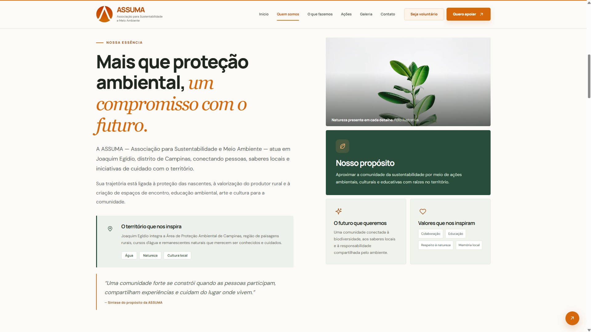
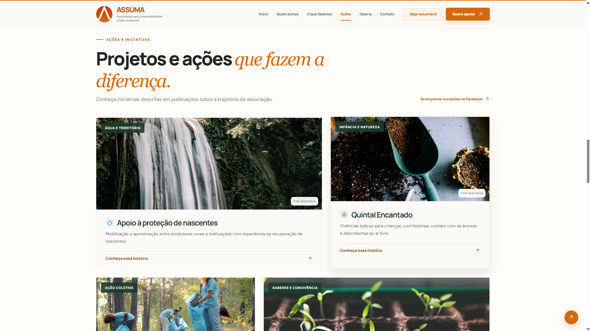
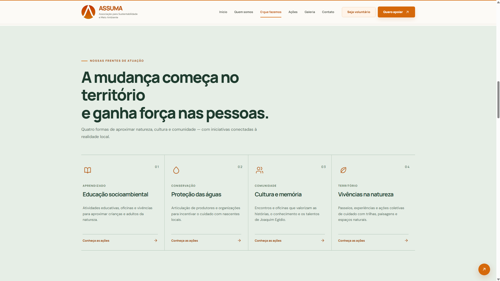
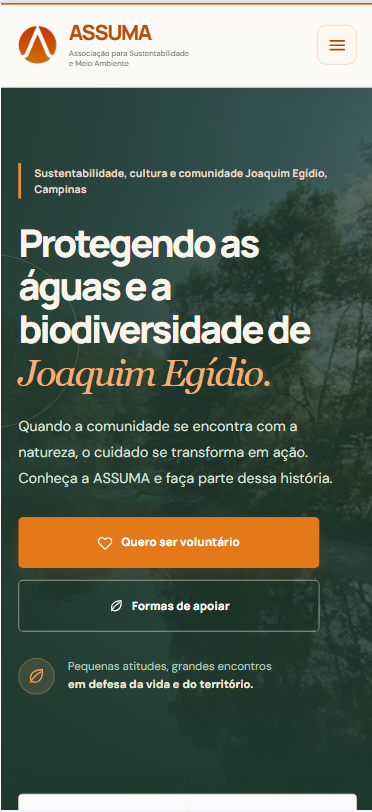
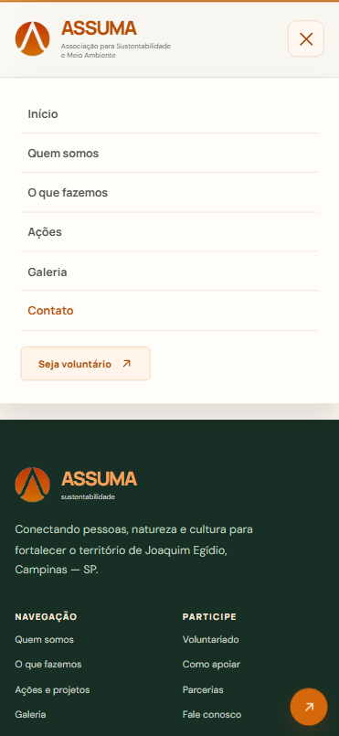

# ASSUMA — Institutional Website

**Responsive landing page | Front-end development | UX/UI**

**English** | [Português (BR)](./README.pt-BR.md)


## Project Preview

### Desktop — Homepage



### Institutional Design

| About Us | Areas of Activity |
|---|---|
|  |  |

### Projects & Initiatives



### Mobile Experience

<p align="center">
  
  &nbsp;&nbsp;
  
</p>

<p align="center">
  <i>Responsive layout and mobile navigation.</i>
</p>

---


## Overview

An institutional website prototype for ASSUMA (Associação para Sustentabilidade e Meio Ambiente), an environmental association connected to Joaquim Egídio, Campinas, Brazil. Developed as part of the 2026/2 Integrated Multidisciplinary Project (PIM) in Systems Analysis and Development at UNIP.

The project explores how responsive design, accessible interfaces and clear information architecture can communicate environmental initiatives and encourage community engagement.

## Features


- Responsive layout for desktop, tablet and mobile devices.
- Semantic HTML, keyboard-friendly navigation and reduced-motion support.
- Interactive mobile menu, active-section highlighting and scroll-based animations using IntersectionObserver.
- Institutional content, environmental initiatives, photo gallery and participation options.
- Client-side contact form validation and simulated submission. No actual messages are sent or stored.

## Technologies

| Technology | Purpose |
|---|---|
| HTML5 | Semantic structure and content |
| CSS3 | Visual identity, responsive layout and components |
| Vanilla JavaScript | Navigation, interaction and form validation |

## Run locally

Clone the repository (requires access while private):

```bash
git clone https://github.com/luansorrilha/assuma-website.git
cd assuma-website
```

Open `index.html` in a modern browser or start a local server with Python:

```bash
python -m http.server 8000
```

Visit `http://localhost:8000`. An internet connection is required for external photographs, web fonts and the embedded map.

## Project structure

```text
assuma-website/
├── assets/       # Local brand assets
├── docs/         # Academic and design documentation
├── index.html    # Page structure
├── style.css     # Styling and responsiveness
├── script.js     # Client-side interactions
└── README.md
```

## Documentation

- [Academic context, sources and image credits (PT-BR)](./docs/PROJECT_CONTEXT.md)
- [Requirements and test scenarios (PT-BR)](./docs/CHECKLIST_PIM.md)
- [Visual design decisions (PT-BR)](./docs/DECISOES_VISUAIS.md)

## Project status and disclaimer

Academic prototype, not the official ASSUMA website. Institutional copy, contact details and brand usage require confirmation by the association before public release. Illustrative photographs do not necessarily depict ASSUMA activities. Third-party materials remain subject to their respective rights and licenses.

Public demo and screenshots are not yet available.
