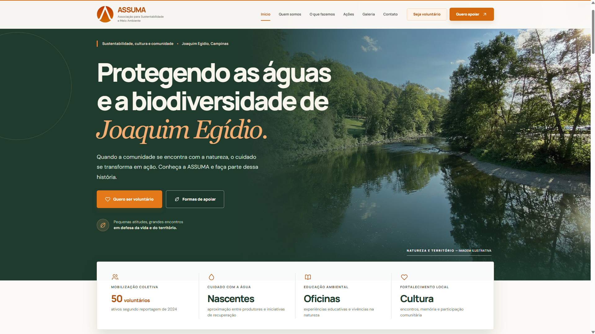
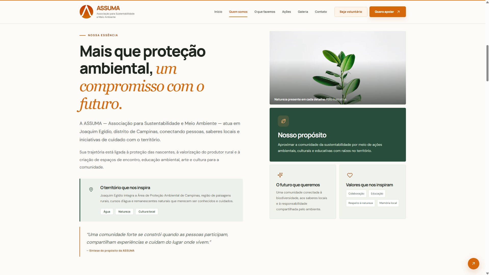
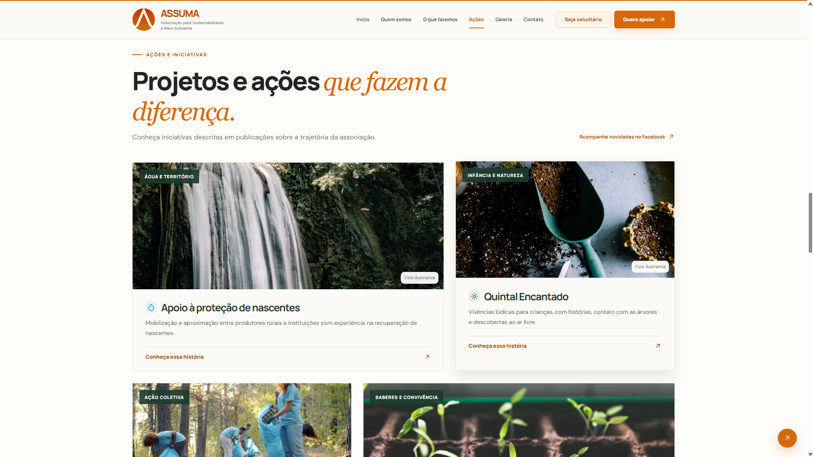
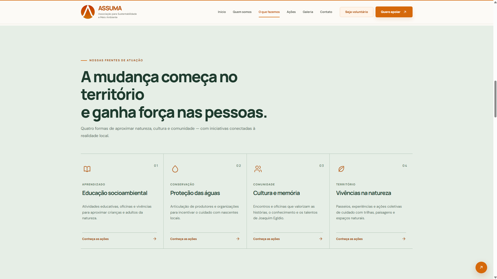
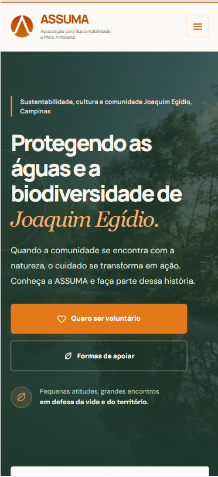
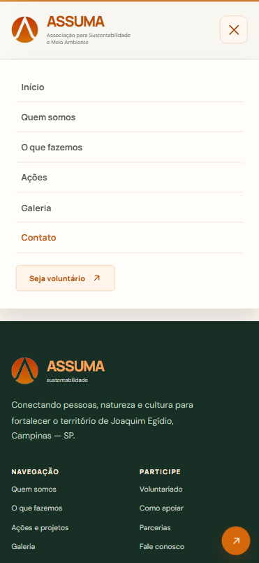

# ASSUMA — Site Institucional

**Landing page responsiva | Desenvolvimento front-end | UX/UI**

[English](./README.md) | **Português (BR)**

[](https://luansorrilha.github.io/assuma-website/)


## Apresentação do Projeto

### Desktop — Página Inicial



### Design Institucional

| Quem Somos | Frentes de Atuação |
|---|---|
|  |  |

### Projetos e Iniciativas



### Experiência Mobile

<p align="center">
  
  &nbsp;&nbsp;
  
</p>

<p align="center">
  <i>Layout responsivo e navegação mobile.</i>
</p>

---


## Visão geral

Protótipo de site institucional para a ASSUMA (Associação para Sustentabilidade e Meio Ambiente), associação ambiental vinculada a Joaquim Egídio, Campinas/SP. Desenvolvido no contexto do Projeto Integrado Multidisciplinar (PIM) 2026/2 de Análise e Desenvolvimento de Sistemas da UNIP.

O projeto explora como design responsivo, interfaces acessíveis e uma arquitetura da informação clara podem comunicar iniciativas ambientais e incentivar a participação comunitária.

## Funcionalidades

- Layout responsivo para desktop, tablet e celular.
- HTML semântico, navegação por teclado e suporte à preferência por movimento reduzido.
- Menu mobile interativo, destaque da seção ativa e animações de rolagem com IntersectionObserver.
- Conteúdo institucional, iniciativas ambientais, galeria e formas de participação.
- Validação do formulário no navegador e envio simulado. Nenhuma mensagem real é enviada ou armazenada.

## Tecnologias

| Tecnologia | Finalidade |
|---|---|
| HTML5 | Estrutura semântica e conteúdo |
| CSS3 | Identidade visual, responsividade e componentes |
| JavaScript puro | Navegação, interações e validação de formulário |

## Executar localmente

Clone o repositório (requer acesso enquanto privado):

```bash
git clone https://github.com/luansorrilha/assuma-website.git
cd assuma-website
```

Abra `index.html` em um navegador atualizado ou inicie um servidor local com Python:

```bash
python -m http.server 8000
```

Acesse `http://localhost:8000`. É necessária conexão com a internet para carregar fotografias externas, fontes web e o mapa incorporado.

## Estrutura do projeto

```text
assuma-website/
├── assets/       # Arquivos locais da marca
├── docs/         # Documentação acadêmica e visual
├── index.html    # Estrutura da página
├── style.css     # Estilos e responsividade
├── script.js     # Interações no navegador
└── README.md
```

## Documentação

- [Contexto acadêmico, fontes e créditos fotográficos](./docs/PROJECT_CONTEXT.md)
- [Requisitos e cenários de teste](./docs/CHECKLIST_PIM.md)
- [Decisões de identidade visual](./docs/DECISOES_VISUAIS.md)

## Status e aviso

Protótipo acadêmico, não é o site oficial da ASSUMA. Textos institucionais, dados de contato e uso da marca devem ser confirmados pela associação antes de uma publicação pública. As fotografias ilustrativas não representam necessariamente ações da ASSUMA. Materiais de terceiros estão sujeitos aos respectivos direitos e licenças.

Demonstração pública e capturas de tela ainda não disponíveis.
